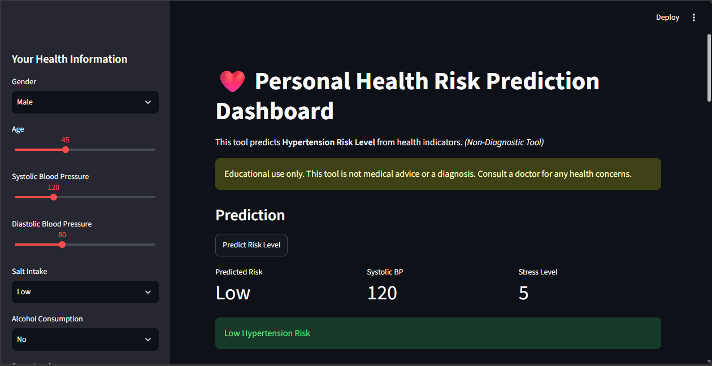
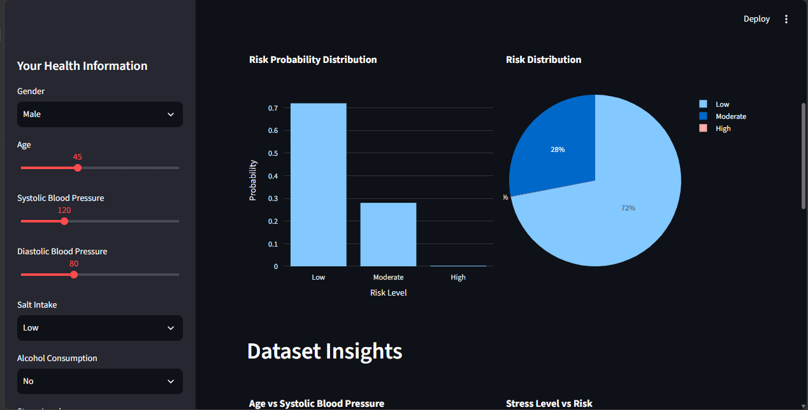
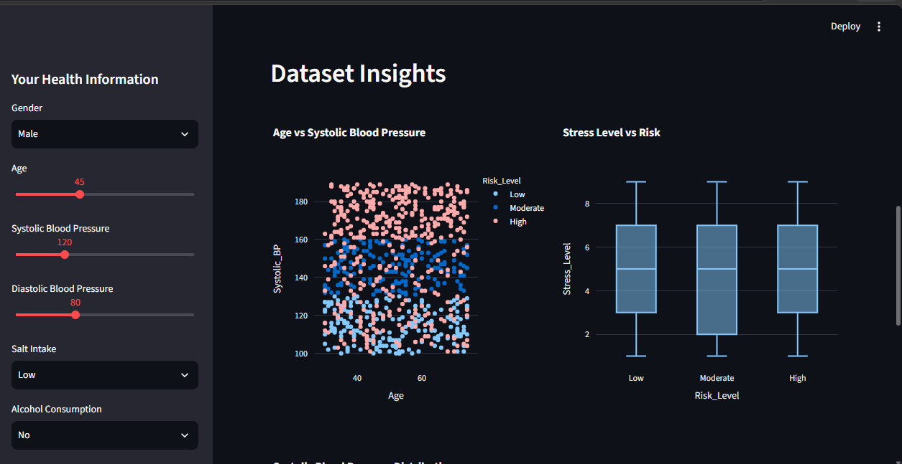
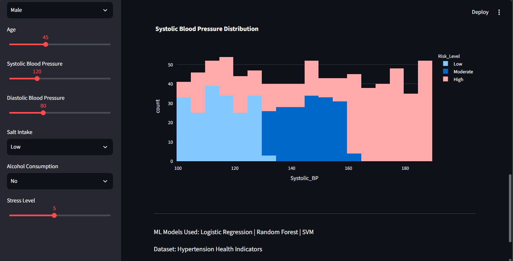

# Personal Health Risk Prediction
**Live demo:** https://personal-health-risk-prediction-dj69r5agzb5xzrivchc7zr.streamlit.app

A Streamlit dashboard that estimates hypertension risk level (Low / Moderate / High) from health indicators. **Educational use only, not medical advice.**

## Problem

Estimates a person's hypertension risk level from blood pressure readings, age, salt intake, alcohol consumption and stress level, and shows charts that explore the underlying dataset.

## Dataset

Hypertension Health Indicators dataset, 800 rows. Target: `Risk_Level` (Low / Moderate / High).

Features: Gender, Age, Systolic_BP, Diastolic_BP, Salt_Intake, Alcohol_Consumption, Stress_Level.

## Approach

- Preprocessing: removed duplicates, checked for missing values, encoded categorical columns (gender, salt intake, alcohol, risk level) as numbers, scaled features with StandardScaler, 80/20 train-test split.
- Models compared: Logistic Regression (76.9%), Random Forest (100%), SVM (91.9%) test accuracy.
- Final model: SVM (RBF kernel, C=10), 91.9% accuracy, weighted F1 of 0.92.
- Finding: Systolic and diastolic blood pressure were the strongest predictors. Salt, alcohol and stress had very little effect in this dataset.

## Tech stack

Python, Pandas, NumPy, Scikit-learn, Plotly, Streamlit

## Run locally

    pip install -r requirements.txt
    streamlit run dashboard/app.py

## Screenshots

## Disclaimer

This tool is not a medical device and does not provide a diagnosis.
